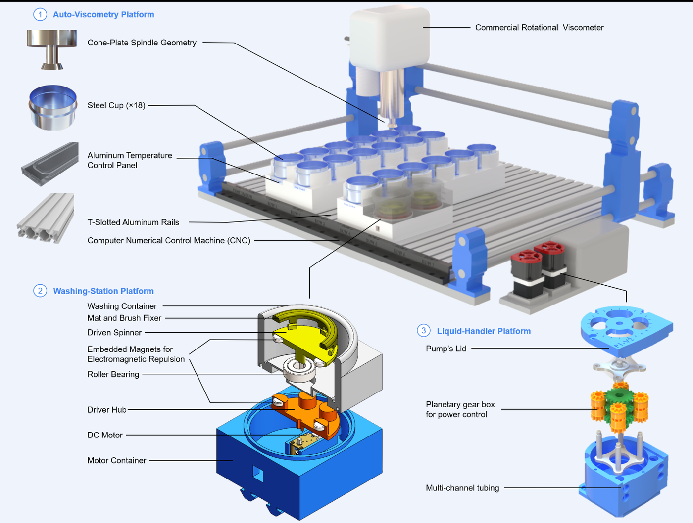
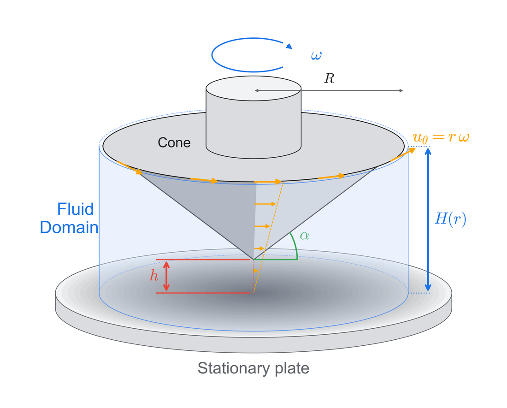
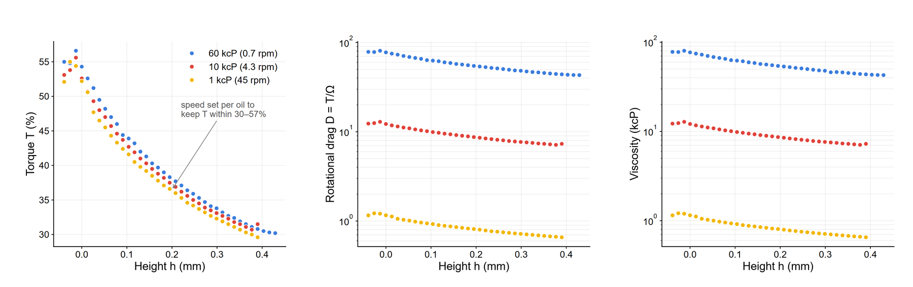
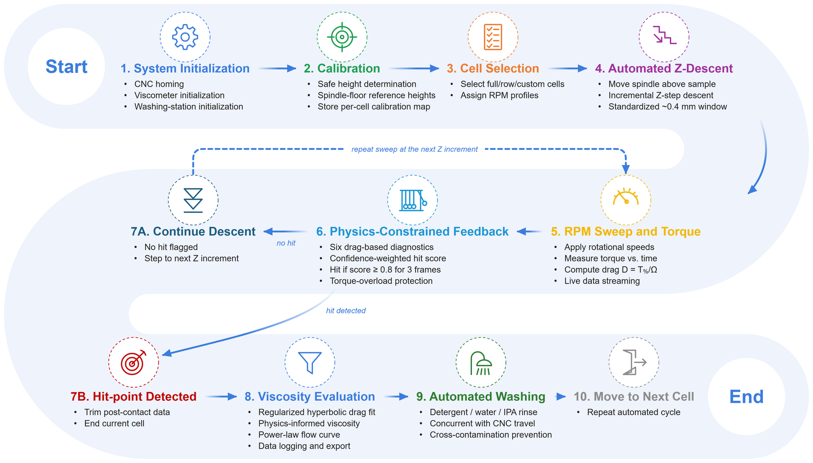
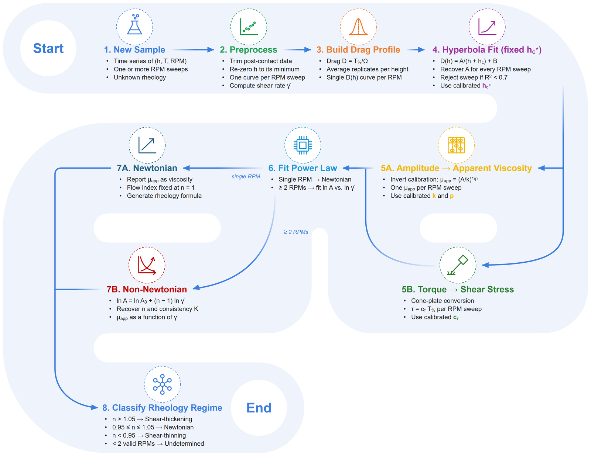
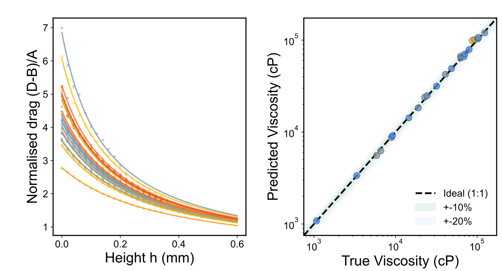
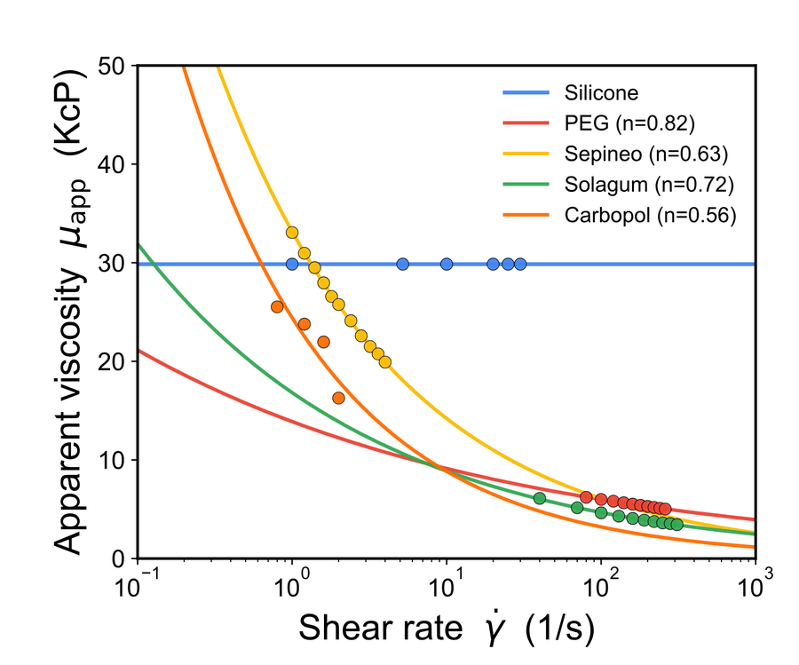
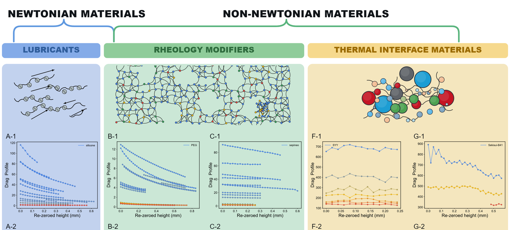
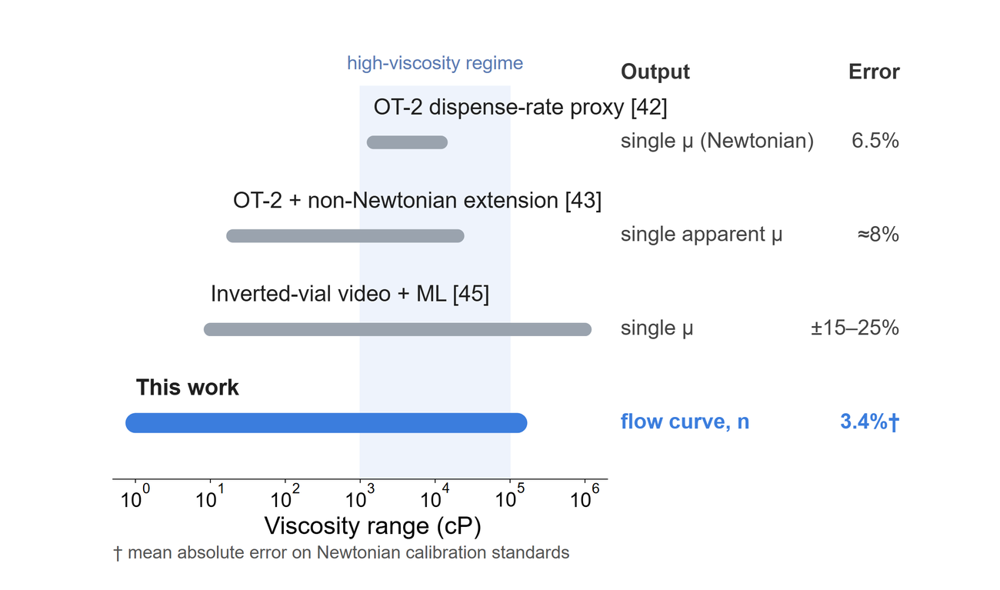
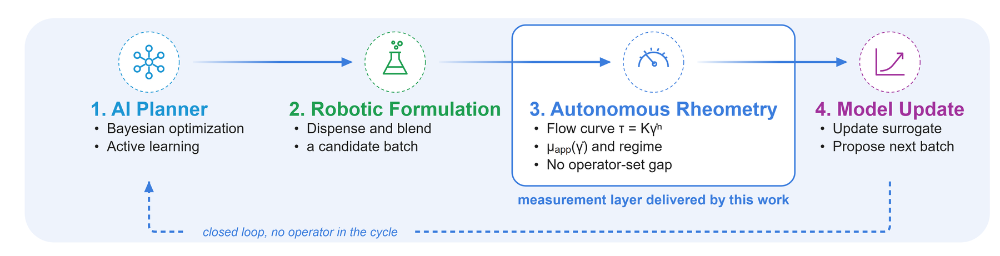

<div align="center">

# AutoVisco

### Physics-informed autonomous rheometry of liquids, gels, and pastes for self-driving laboratories

**Rotational rheometry, rebuilt as a measurement layer for self-driving laboratories.**

[](https://ac-formulations-sdl5.github.io/AutoVisco/)
[](LICENSE)
[](data/LICENSE.md)
[](pyproject.toml)

[Website](https://ac-formulations-sdl5.github.io/AutoVisco/) ·
[Data](data/README.md) ·
[Quick start](#quick-start) ·
[Reproduce the figures](#reproducing-the-paper) ·
[Cite](#citation)



</div>

---

## Why AutoVisco

Self-driving laboratories can already *decide* which formulation to make next. What they usually cannot do is
**measure how a viscous formulation flows** without a person at the bench. Automated viscometry today mostly
repurposes pipetting robots or cameras as proxies, and every one of them returns a **single, Newtonian viscosity
value**. Shear-thinning and structure-forming formulations, the ones that matter for coatings, adhesives,
personal care, and polymer processing, stay invisible to the optimizer.

AutoVisco closes that gap. Instead of chasing micrometre-precise gap setting, it treats the spindle's **descent**
as the signal and lets physics decode it.

<table>
<tr>
<td align="center"><h3>3.4%</h3>mean absolute error on Newtonian standards</td>
<td align="center"><h3>95.7%</h3>of calibration samples within ±10%</td>
<td align="center"><h3>n = 1.00 → 0.39</h3>Newtonian to strongly shear-thinning</td>
<td align="center"><h3>4.7×</h3>faster than the manual workflow</td>
<td align="center"><h3>&lt; 20 min</h3>hands-on time for 18 samples</td>
</tr>
</table>

## How it works

<table>
<tr>
<td width="46%"></td>
<td>

**Physics first.** As the rotating cone approaches the plate, the liquid gap is
$H(r) = h + r\tan\alpha$ and lubrication theory gives the torque

$$T = 2\pi\mu\omega \int_0^R \frac{r^3}{H(r)}\,dr$$

continuously across the parallel-plate, transition, and cone-and-plate regimes.

**Then a constrained fit.** The rotational drag $D = T/\Omega$ (percent torque over spindle speed) follows a
regularized hyperbola

$$D(h) = \frac{A}{h + h_c} + B$$

where $A$ carries the viscosity and $h_c$ absorbs backlash, compliance, and gap-zero uncertainty, so the
absolute gap never has to be known.

**Then rheology.** Repeating the descent at several speeds turns $A(\dot\gamma)$ into a flow curve
$\tau = K\dot\gamma^{\,n}$ and a rheological class.

</td>
</tr>
</table>

### One descent, three signatures

Torque, rotational drag, and viscosity recorded during a descent separate cleanly by viscosity, which is the
observation the whole platform is built on.



### Closed-loop operation

Calibration, incremental Z-descent, physics-constrained hit-point detection, viscosity evaluation, and
concurrent washing run as one operator-free loop.



### One inference chain for every chemistry

The same pipeline, with constants $h_c^\star$, $k$, $p$, and $c_\tau$ calibrated once on silicone oils, handles
Newtonian and non-Newtonian samples alike. No per-chemistry retuning.



## Results at a glance

<table>
<tr>
<td width="55%"></td>
<td>

**Universal gap physics.** Normalized drag profiles of 23 silicone standards collapse onto one master shape,
so viscosity lives entirely in the amplitude $A$, and predicted viscosities follow the parity line across more
than two orders of magnitude.

</td>
</tr>
<tr>
<td width="55%"></td>
<td>

**From lubricants to gels.** Silicone stays Newtonian while PEG, Solagum, Sepineo, and Carbopol shear-thin
progressively, all resolved by one calibrated model stack.

</td>
</tr>
</table>



### Where it sits



AutoVisco is the only automated method in this comparison that returns a full flow curve rather than a single
viscosity value, which is exactly what a planner needs to optimize rheology itself.



---

## Quick start

```bash
git clone https://github.com/AC-Formulations-SDL5/AutoVisco.git
cd AutoVisco
python -m venv .venv && .venv\Scripts\activate      # macOS/Linux: source .venv/bin/activate
pip install -e ".[analysis,dev]"
pytest                                              # 102 tests, hardware tests are skipped
```

**Explore the data without hardware**

```bash
python examples/live_pipeline_demo.py data/06_materials/sepineo.csv
jupyter lab analysis/figure8_material_rheology.ipynb
```

**Run the platform (hardware + web interface)**

```bash
python run_viscometry.py        # or: python -m viscometry
```

The web dashboard (Flask + Socket.IO) streams live torque–displacement traces, batch progress, and the
fitted flow curve, with manual override, abort, and calibration controls.

<details>
<summary><b>Hardware setup</b></summary>

| Component | Role | Configure in |
| --- | --- | --- |
| Genmitsu 4040-PRO CNC (GRBL) | Cartesian motion | `src/viscometry/hardware/cnc.py` (`SERIAL_PORT`) |
| AMETEK Brookfield torquemeter, 3° cone, R = 12 mm | Torque acquisition | `src/viscometry/run/settings.py` (`VISCO_PORT`) |
| ESP32 + L298N drivers | Pumps and washing motors | `firmware/esp32/`, `ESP32_PORT` |
| Deck and washing coordinates | Sample and wash positions | `config/locations.yaml` |

The torquemeter is driven from a separate **32-bit Python** runtime (`PYTHON32` in `settings.py`) through
Brookfield's proprietary `DVT_COM.dll`, which is not redistributed here. See
[`worker32/README.md`](src/viscometry/hardware/viscometer/worker32/README.md).
Set `VISCOMETRY_SECRET_KEY` in the environment for a fixed Flask session key.

</details>

## Repository layout

```
AutoVisco/
├── src/viscometry/        Python package
│   ├── hardware/          CNC, pump (ESP32), and viscometer clients (64-bit host + 32-bit worker)
│   ├── measurement/       Real-time drag feedback and confidence-weighted hit-point detection
│   ├── analysis/          Regularized-hyperbola fitting and CSV loaders
│   ├── rheology/          Calibration constants, flow-curve inference, live characterization engine
│   ├── discovery/         Torque-ladder RPM discovery for unknown samples
│   ├── calibration/       Per-cell Z calibration store
│   ├── run/               Experiment controller, settings, and export
│   └── web/               Flask + Socket.IO dashboard backend
├── web/                   Dashboard templates and static assets
├── config/                Deck and washing-station coordinates
├── firmware/esp32/        Washing-station firmware
├── data/                  All datasets behind the manuscript (CSV), see data/README.md
├── analysis/              Notebook and core module reproducing the material rheology results
├── figures/               Scripts that regenerate the vector figures
├── examples/              Hardware-free demos
├── scripts/               Calibration utilities
├── tests/                 pytest suite
└── docs/                  Project website (GitHub Pages)
```

## Data availability

Every dataset behind the manuscript is in [`data/`](data/README.md) as plain CSV, released under
**CC BY 4.0**.

| Folder | Contents | Used in |
| --- | --- | --- |
| [`01_manual_descent`](data/01_manual_descent) | Manual vs. automated descent, three silicone oils | Fig. 2B–D, Fig. 7K |
| [`02_hitpoints`](data/02_hitpoints) | Contact (hit-point) heights per cell | Fig. 4B |
| [`03_silicone_calibration`](data/03_silicone_calibration) | Calibration runs on silicone standards | Fig. 4, Fig. 7A–G |
| [`04_reproducibility`](data/04_reproducibility) | Repeat runs at 12.5 and 37 kcP | Robustness tests |
| [`05_time_series`](data/05_time_series) | Torque time series per height | Fig. 7 |
| [`06_materials`](data/06_materials) | Silicone, PEG, Sepineo, Solagum, Carbopol, SYY, Sekisui B-41, HY-500 | Fig. 8, Fig. 9 |
| [`07_reference_viscometry`](data/07_reference_viscometry) | Manual reference readings | Reference rheology |
| [`08_analysis_outputs`](data/08_analysis_outputs) | Model comparison, bootstrap, leave-one-out, master curve | Fig. 4, Fig. 7H–J, Fig. S2 |
| [`09_simulation`](data/09_simulation) | Lubrication-model torque vs. gap | Model validation |

## Reproducing the paper

| Result | How |
| --- | --- |
| Material rheology (Fig. 8, Fig. 9A) | `analysis/figure8_material_rheology.ipynb` regenerates `rheology_pipeline_summary.csv` and the stress panels |
| Manual descent (Fig. 2B–D) | `python figures/figure2_v2.py data/01_manual_descent/manual_vs_auto_drag.csv figures figures/inputs/Figure2A_manual_protocol_biorender.png` |
| Workflow and pipeline (Fig. 3, Fig. 5) | `python figures/workflow_figures_v2.py figures` |
| Method landscape and closed loop (Fig. 9) | `python figures/figure9_v2.py figures/inputs/Figure9_master_flowcurve_original.svg figures` |

## Citation

If you use AutoVisco, its data, or its code, please cite:

```bibtex
@article{rastegardoost2026autovisco,
  title   = {AutoVisco: Physics-Informed Autonomous Rheometry of Liquids, Gels, and Pastes
             for Self-Driving Laboratories},
  author  = {Rastegardoost, Mohammad M. and Ngunga, Ian and Gaborekwe, Koketso and Bao, Zeqing and
             Naguib, Hani and Le Devedec, Frantz},
  journal = {Digital Discovery},
  year    = {2026},
  note    = {Submitted}
}
```

## Team

Mohammad M. Rastegardoost, Ian Ngunga, Koketso Gaborekwe, Zeqing Bao, Hani Naguib, and Frantz Le Devedec.
**Acceleration Consortium**, University of Toronto, with the University of Toronto Scarborough and the
University of Waterloo.

This research was funded in part by the Canada First Research Excellence Fund (CFREF-2022-00042) through the
Acceleration Consortium and by SEKISUI CHEMICAL CO., LTD.

## Contact

| | Email | LinkedIn |
| --- | --- | --- |
| **Mohammad (Mahdi) Rastegardoost** | [m.rastegardoost@utoronto.ca](mailto:m.rastegardoost@utoronto.ca) · [m.rastegardoost@gmail.com](mailto:m.rastegardoost@gmail.com) | [linkedin.com/in/mahdirstgr](https://www.linkedin.com/in/mahdirstgr/) |
| **Frantz Le Devedec** | [frantz.ledevedec@utoronto.ca](mailto:frantz.ledevedec@utoronto.ca) | [linkedin.com/in/frantzld56](https://www.linkedin.com/in/frantzld56/) |

Questions, collaborations, and bug reports are welcome by email or through
[GitHub issues](https://github.com/AC-Formulations-SDL5/AutoVisco/issues).

## License

Code is released under the [MIT License](LICENSE). Data in [`data/`](data) are released under
[CC BY 4.0](data/LICENSE.md).
